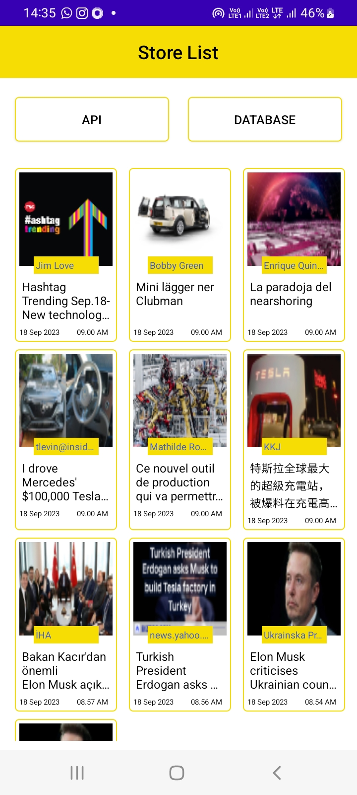
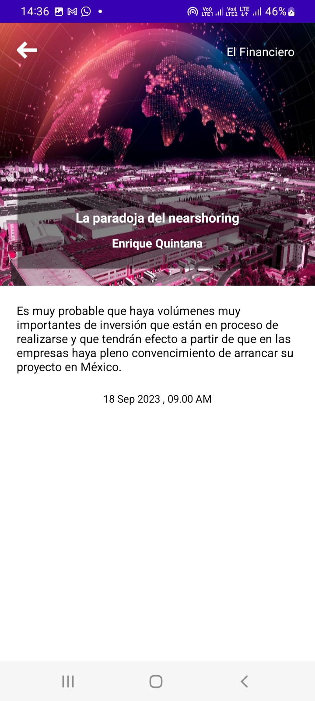

# List and Detail Screen with Background Data Fetching: API & Database

#  Architecture
This is application that consists of two screens: a list screen and a detail screen.
List screen with two buttons: 
API button -to get data from api
Database button- to get data from database

The application should fetch data from a web service and display it in a list
format. When a user selects an item from the list, they should be taken to the detail screen
where more information about the selected item is displayed.

Programming Language: KOTLIN
Architecture pattern : MVVM
RETROFIT SDK [Image caching and Network call]
Jetpack components such as LiveData and ViewModel.

## 📸 Screenshots

